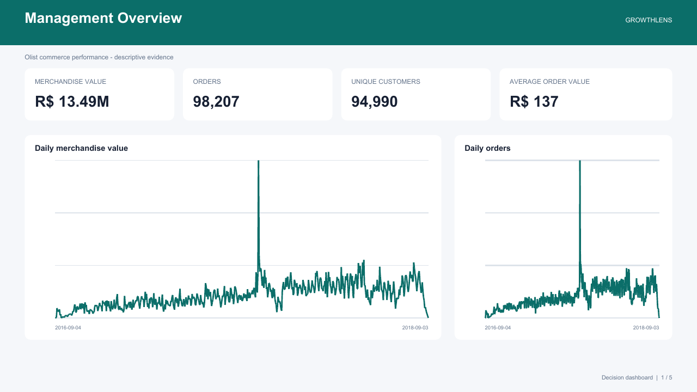
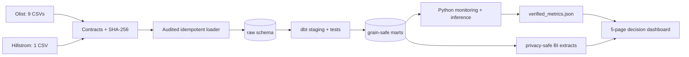

# GrowthLens

> A reproducible analytics engineering and experimentation portfolio: audited public data,
> grain-safe SQL marts, monitored business KPIs, randomized-experiment inference, and a
> five-page decision-dashboard preview with a Power BI implementation blueprint.

[](https://github.com/Clambq/growthlens/actions/workflows/ci.yml)
[](https://www.python.org/)
[](https://www.getdbt.com/)
[](LICENSE)



## Why this project

Most portfolio dashboards begin after the difficult decisions have already been hidden. GrowthLens
keeps the full analytical chain visible: input contracts, audited loading, SQL grain decisions,
quality tests, statistical validity, metric artifacts, and decision reporting.

It contains two independent public-data cases. They share engineering standards but are never
joined or represented as one company:

- **Commerce Performance Observatory:** 98,207 commercial orders from the anonymized Olist
  marketplace, modeled without item/payment/review fan-out.
- **Experiment Decision Lab:** 64,000 randomized Hillstrom customers, with sample-ratio checks,
  confidence intervals, Holm multiplicity control, tested CUPED utilities, baseline-balance gates,
  and guarded segment analysis. Primary published effects are unadjusted per the frozen plan.

## Verified findings

All values below are generated in [`artifacts/verified_metrics.json`](artifacts/verified_metrics.json);
they are not manually typed into the analysis pipeline.

| Decision signal | Verified result | Interpretation |
| --- | ---: | --- |
| Commercial orders | 98,207 | descriptive |
| Merchandise value | R$13.49M | freight excluded; descriptive |
| Unique commercial customers | 94,990 | full-period distinct customer grain |
| Repeat-customer rate | 3.04% | customers with more than one commercial order |
| On-time delivery | 91.89% | overall eligible deliveries; associational context |
| Average review score | 4.12 / 5 | reviewed commercial orders |
| Men's email conversion effect | +0.68 pp, 95% CI [0.50, 0.86] | randomized; Holm p < 0.001 |
| Women's email conversion effect | +0.31 pp, 95% CI [0.15, 0.47] | randomized; Holm p < 0.001 |
| Sample-ratio mismatch test | p = 0.9037 | no SRM evidence at the frozen threshold |
| Maximum baseline \|SMD\| | 0.0086 | below the frozen 0.10 balance threshold |

Commerce delivery/review findings are associations. Only the Hillstrom treatment comparisons are
described causally because treatment was randomized and passed the pre-specified validity gates.

## Architecture



See [architecture](docs/architecture.md) for grains, boundaries, failure modes, and design choices.

## Reproduce on Windows PowerShell

Prerequisites: Python 3.11+, Git, and optionally Docker Desktop / Power BI Desktop. The default local
path uses DuckDB, so Docker is not required.

```powershell
git clone https://github.com/Clambq/growthlens.git
cd growthlens
python -m venv .venv
.\.venv\Scripts\python.exe -m pip install -e ".[dev,analytics]"
```

Download the two public datasets by following [`data/README.md`](data/README.md), then run:

```powershell
$env:DATABASE_URL = "duckdb:///artifacts/growthlens.duckdb"
$env:GROWTHLENS_DUCKDB_PATH = (Resolve-Path .\artifacts).Path + "\growthlens.duckdb"
.\.venv\Scripts\python.exe scripts\run_pipeline.py all
.\.venv\Scripts\python.exe -m pytest -q
.\.venv\Scripts\python.exe -m ruff check src scripts tests
```

The same stages are exposed separately:

```powershell
make verify
make build
make report
make test
make lint
```

`make pipeline` runs verification, audited loading, dbt, evidence artifacts, BI extracts, and the
dashboard in fail-fast order. Re-running it is safe: source rows remain idempotent while each load
receives a fresh audit record.

## Dashboard

The repository includes a candid Power BI implementation blueprint: documented semantic-model
grains, DAX, theme, deterministic extracts, five rendered PNG pages, and a PDF. It does **not**
claim to include a Power BI Desktop-authored PBIP/PBIX; the reviewable preview is generated from
the same tested extracts and metric artifact.

1. Management Overview
2. Revenue and Customer Growth
3. Fulfillment and Seller Operations
4. Experiment Decision
5. Data Quality

[Open the five-page dashboard PDF](powerbi/GrowthLens-dashboard.pdf) or read the
[Power BI handoff](powerbi/README.md).

## Quality gates

- 76 passing Python/integration tests locally plus 101 dbt model/data checks on the public dataset
  (one PostgreSQL-only smoke test runs in CI).
- Exact reconciliation fixtures for multi-item, multi-payment, duplicate-review, canceled-order,
  repeated-customer, early-delivery, and late-delivery cases.
- Explicit experiment contract: conversion primary outcome, two treatment-vs-control comparisons,
  Holm adjustment, 95% intervals, fixed seed, and post-treatment covariate rejection.
- No raw data, credentials, local databases, private identifiers, or user paths in Git history.
- CI runs unit, fixture reconciliation, DuckDB/dbt integration, PostgreSQL ingestion smoke,
  notebook execution, and full-history hygiene checks; the full public-data build remains the
  documented local release workflow because CI does not download Kaggle data.

## Repository map

| Path | Purpose |
| --- | --- |
| `src/growthlens/` | contracts, ingestion, monitoring, experimentation, reporting, orchestration |
| `dbt/` | staging, intermediate models, marts, and data tests |
| `notebooks/` | thin explanatory notebooks; business logic stays in tested modules |
| `powerbi/` | BI contract, DAX, theme, rendered screenshots, and PDF preview |
| `reports/` | metric catalog, experiment contract, decision memo, and limitations |
| `docs/` | architecture, interview guide, and resume evidence ledger |
| `tests/` | unit, integration, statistical, hygiene, and reconciliation tests |

## Honest scope

GrowthLens is a personal portfolio project using public data, not employment experience and not a
production system operated for Olist or MineThatData. The source datasets remain subject to their
own licenses and attribution terms; see [NOTICE](NOTICE.md).
