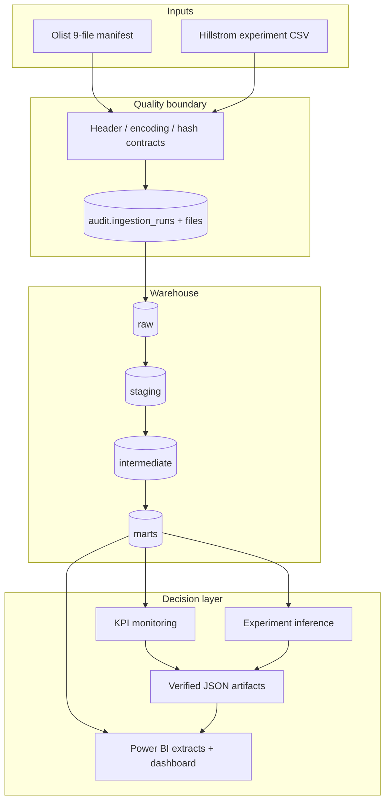

# Architecture and analytical contracts

## System boundary

GrowthLens treats Olist commerce data and the Hillstrom randomized experiment as separate cases.
They share tooling and evidence conventions, but no entity or event crosses between them.

## Grain contracts

| Relation | Grain | Primary reconciliation risk |
| --- | --- | --- |
| `fct_orders` | one row per order | item/payment/review fan-out |
| `fct_order_items` | one row per order item | duplicate line identity |
| `mart_daily_kpis` | one row per purchase date | mixing sums and rates |
| `mart_customer_cohorts` | customer x activity month | cohort reassignment |
| `mart_seller_scorecard` | one row per seller | small-volume ranking noise |
| `fct_experiment_assignments` | one row per randomized customer | duplicate assignment |
| `fct_experiment_outcomes` | one row per randomized customer | post-treatment leakage |
| `mart_experiment_summary` | one row per randomized segment | incorrect denominators |

Each one-to-many commerce relation is aggregated at order grain before joining. Merchandise value,
freight value, and payment value remain distinct measures. Canceled and unavailable orders remain
auditable but are excluded from commercial KPI denominators by one centralized scope model.

## Runtime profiles

- **Local/reviewer:** DuckDB file, vectorized public CSV ingestion, dbt-duckdb.
- **Production-shaped/CI:** PostgreSQL 16, the same schemas and SQLAlchemy audit contract,
  dbt-postgres compatibility.
- **Reporting:** stable CSV extracts with declared keys and pseudonymous seller keys; raw customer
  and order identifiers never enter the BI layer.

## Failure behavior

1. Missing files, column drift, BOM/encoding mismatch, or malformed rows fail before loading.
2. A load is transactional and records a succeeded/failed audit attempt.
3. Repeated source rows are ignored by deterministic row hashes.
4. dbt relationship, uniqueness, accepted-value, and custom grain tests stop downstream reporting.
5. Experiment reporting stops on invalid expected shares or sample-ratio mismatch.
6. Artifact serialization rejects NaN/Infinity and requires analysis-type labels and intervals.
7. The orchestrator stops after the first failed stage and returns the actionable diagnostic.

## Why these choices

- **dbt over notebook transformations:** makes grains, dependencies, and quality gates reviewable.
- **DuckDB plus PostgreSQL:** low-friction local reproduction without abandoning a server database
  path that matches analyst job descriptions.
- **Machine-readable metric artifact:** prevents resume, README, and dashboard numbers from drifting.
- **PBIP/TMDL plus PDF:** keeps the semantic model diffable and the visual result reviewable even
  when Power BI Desktop is unavailable.
- **Robust median/MAD monitoring:** tolerates non-normal operational series and makes the zero-MAD
  behavior explicit.
- **Difference in proportions plus Holm:** matches the frozen binary primary outcome and controls
  the two-comparison family without data-dependent method shopping.
